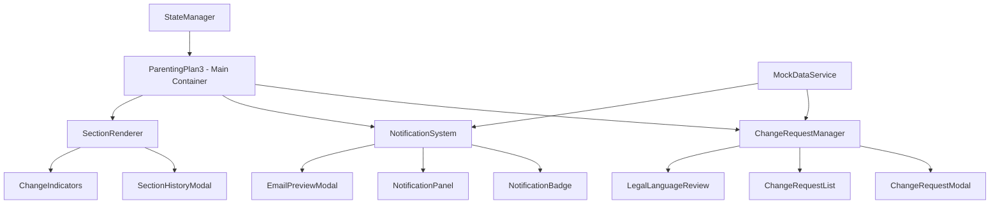
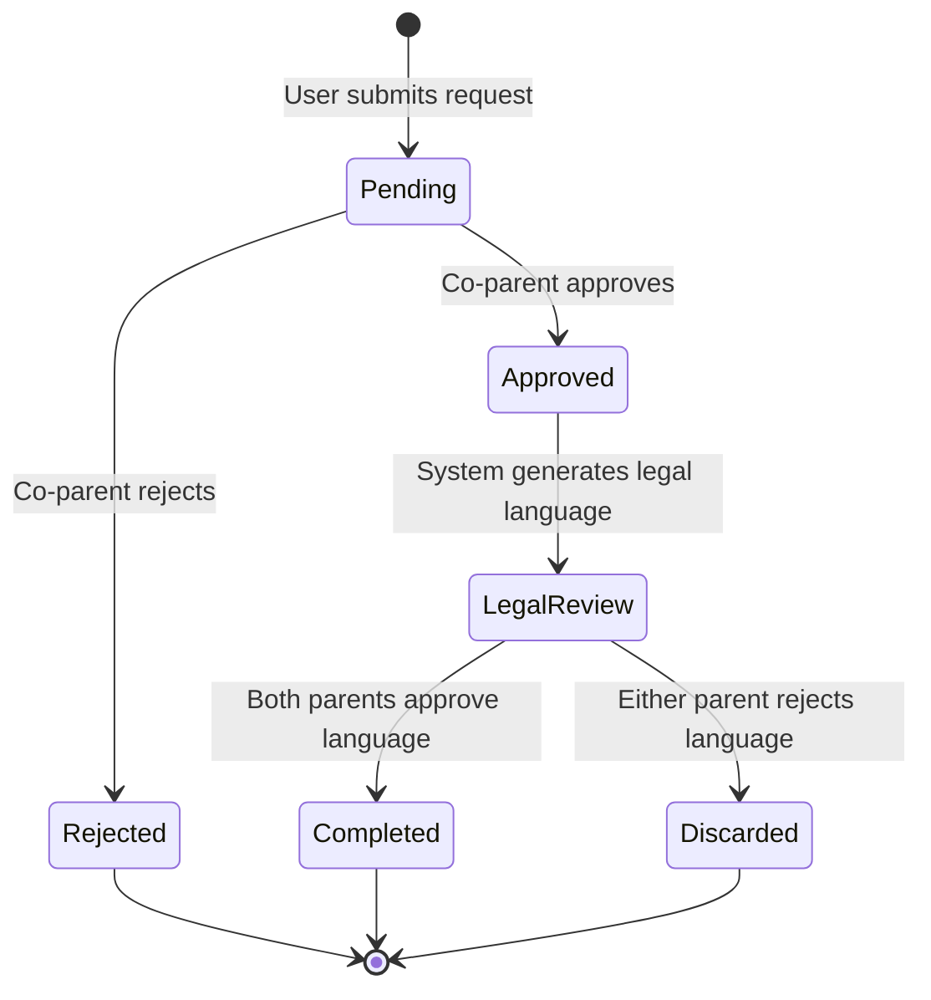

# Design Document

## Overview

The collaborative parenting plan editing feature enables co-parents to propose, review, and approve changes to their parenting plan through a structured workflow. The design emphasizes transparency, clear communication, and conflict reduction by requiring mutual consent for all modifications while maintaining a complete audit trail.

The system operates as a frontend prototype with simulated backend interactions, email notifications, and realistic timing delays to demonstrate the complete user experience. The design integrates seamlessly with the existing parenting plan interface while adding collaborative editing capabilities.

## Architecture

### Component Architecture



### Data Flow

1. **Change Request Initiation**: User clicks "Request Changes" → Modal opens → User submits description → Request created
2. **Notification Flow**: Request created → Email simulation triggered → In-app notification updated → Co-parent notified
3. **Review Process**: Co-parent reviews → Approves/Rejects → Legal language generated (if approved) → Final approval phase
4. **Completion**: Both parties approve legal language → Section updated → History recorded → Notifications sent

### State Management

The feature uses React state management with the following key state objects:

- `changeRequests`: Array of all change requests with status tracking
- `notifications`: In-app notification queue
- `sectionHistory`: Version history for each section
- `currentUser`: Demo mode user perspective (Parent A or Parent B)
- `emailQueue`: Simulated email notifications

## Components and Interfaces

### Core Components

#### ChangeRequestManager
**Purpose**: Orchestrates the entire change request workflow
**Props**:
- `sectionId: string` - Target section for changes
- `onRequestSubmit: (request: ChangeRequest) => void`
- `onStatusUpdate: (requestId: string, status: RequestStatus) => void`

**State**:
- `activeRequests: ChangeRequest[]`
- `pendingApprovals: LegalLanguageApproval[]`

#### ChangeRequestModal
**Purpose**: Captures change request details from users
**Props**:
- `isOpen: boolean`
- `sectionTitle: string`
- `onSubmit: (description: string) => void`
- `onClose: () => void`

**Features**:
- Rich text description input with 20-character minimum
- Section context display
- Form validation and error handling

#### NotificationSystem
**Purpose**: Manages in-app and simulated email notifications
**Props**:
- `notifications: Notification[]`
- `onMarkAsRead: (notificationId: string) => void`
- `currentUser: UserRole`

**Features**:
- Badge counter for unread notifications
- Dropdown panel with notification list
- Email preview functionality

#### LegalLanguageReview
**Purpose**: Presents generated legal language for approval
**Props**:
- `originalContent: string`
- `proposedChanges: string`
- `generatedLanguage: string`
- `onApprove: () => void`
- `onReject: () => void`

**Features**:
- Side-by-side comparison view
- Highlighted changes
- Approval tracking for both parents

#### SectionHistoryModal
**Purpose**: Displays version history for plan sections
**Props**:
- `sectionId: string`
- `history: SectionVersion[]`
- `isOpen: boolean`
- `onClose: () => void`

**Features**:
- Chronological timeline view
- Expandable version details
- Change attribution and timestamps

### Data Interfaces

```typescript
interface ChangeRequest {
  id: string;
  sectionId: string;
  requestingParent: 'parentA' | 'parentB';
  description: string;
  status: 'pending' | 'approved' | 'rejected' | 'completed' | 'discarded';
  createdAt: Date;
  respondedAt?: Date;
  legalLanguage?: string;
  legalLanguageApprovals?: {
    parentA: boolean | null;
    parentB: boolean | null;
  };
}

interface Notification {
  id: string;
  type: 'change_request' | 'approval_needed' | 'request_approved' | 'request_rejected' | 'modification_complete';
  title: string;
  message: string;
  actionUrl?: string;
  isRead: boolean;
  createdAt: Date;
  relatedRequestId?: string;
}

interface SectionVersion {
  id: string;
  sectionId: string;
  content: string;
  changeDescription?: string;
  modifiedBy?: 'parentA' | 'parentB';
  modifiedAt: Date;
  changeRequestId?: string;
}

interface EmailNotification {
  id: string;
  to: string;
  subject: string;
  body: string;
  type: 'change_request' | 'approval_response' | 'legal_review' | 'modification_complete';
  sentAt: Date;
}
```

## Data Models

### Change Request Lifecycle



### Section Modification States

- **Original**: Unchanged from initial plan
- **Modified**: Contains approved modifications
- **Pending**: Has active change requests
- **Under Review**: Legal language being reviewed

### Mock Data Structure

The prototype includes comprehensive mock data to demonstrate all workflow states:

- Pre-existing change requests in various states
- Sample email notifications
- Section history with multiple versions
- Realistic legal language examples
- Simulated timing delays for async operations

## Error Handling

### User Input Validation
- Change request descriptions must be at least 20 characters
- Prevent duplicate requests for the same section
- Validate user permissions for actions

### System Error States
- Network simulation failures
- Email delivery simulation errors
- Concurrent modification conflicts
- Invalid state transitions

### Error Recovery
- Clear error messages with suggested actions
- Ability to retry failed operations
- Graceful degradation for non-critical features
- Automatic cleanup of orphaned requests

## Testing Strategy

### Unit Testing
- Component rendering with various props
- State management logic
- Mock data service functions
- Notification system behavior

### Integration Testing
- Complete change request workflow
- Email notification simulation
- Multi-user perspective switching
- Section history tracking

### User Experience Testing
- Workflow completion scenarios
- Error handling paths
- Responsive design validation
- Accessibility compliance

### Demo Scenarios
1. **Happy Path**: Complete change request from initiation to approval
2. **Rejection Path**: Change request rejected by co-parent
3. **Legal Language Rejection**: Approved request with rejected legal language
4. **Multiple Requests**: Concurrent requests for different sections
5. **History Review**: Viewing section modification history

## Visual Design

### UI Patterns

#### Change Request Indicators
- Subtle orange border on sections with pending requests
- Badge showing request count
- Status icons (pending, approved, rejected)

#### Notification Design
- Non-intrusive badge counter in header
- Slide-down notification panel
- Color-coded notification types

#### Modal Layouts
- Consistent header with clear titles
- Progressive disclosure for complex workflows
- Clear primary and secondary actions

#### History Visualization
- Timeline-style layout for version history
- Expandable cards for detailed changes
- Visual diff highlighting

### Color Scheme
- **Pending**: Orange (#f59e0b)
- **Approved**: Green (#10b981)
- **Rejected**: Red (#ef4444)
- **In Review**: Blue (#3b82f6)
- **Completed**: Purple (#8b5cf6)

### Typography
- Consistent with existing plan typography
- Clear hierarchy for different content types
- Monospace font for legal language diffs

## Performance Considerations

### State Optimization
- Efficient re-rendering with React.memo
- Selective state updates to minimize cascading changes
- Lazy loading of section history

### Simulation Performance
- Realistic but not excessive timing delays
- Efficient mock data generation
- Minimal DOM manipulation for animations

### Memory Management
- Cleanup of completed change requests
- Notification pruning after read
- Efficient history storage

## Accessibility

### Keyboard Navigation
- Full keyboard support for all interactive elements
- Logical tab order through workflows
- Escape key handling for modals

### Screen Reader Support
- Proper ARIA labels for dynamic content
- Status announcements for state changes
- Descriptive button and link text

### Visual Accessibility
- High contrast for status indicators
- Clear focus indicators
- Scalable text and UI elements

## Security Considerations

### Data Validation
- Input sanitization for change descriptions
- Proper escaping of user-generated content
- Validation of state transitions

### User Authorization
- Proper role-based access control simulation
- Prevention of unauthorized actions
- Clear user context indicators

### Privacy Protection
- No sensitive data in mock examples
- Proper handling of simulated email content
- Clear data boundaries in prototype